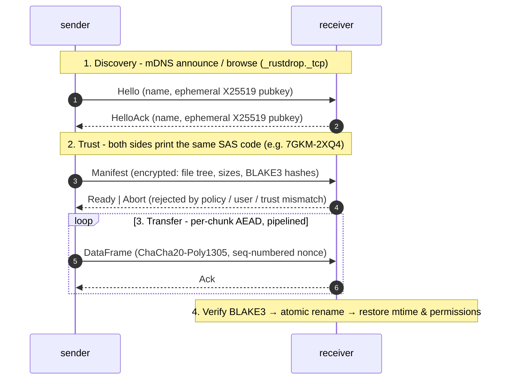
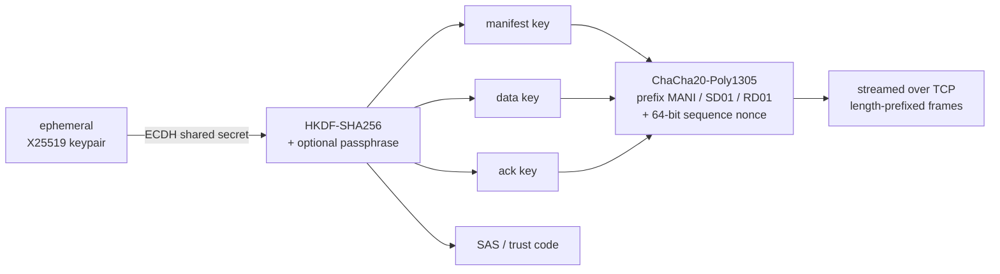

<p align="center">
  
</p>

<h1 align="center">RustDrop</h1>

<p align="center">
  <strong>Privacy-first, blazing-fast file transfer for your local network.</strong><br/>
  No cloud. No accounts. No telemetry. Your bytes never leave the LAN.
</p>

<p align="center">
  <a href="https://github.com/hakuxyz/rustdrop/actions/workflows/ci.yml"></a>
  <a href="https://github.com/hakuxyz/rustdrop/blob/main/LICENSE"></a>
  <a href="https://crates.io/crates/rustdrop"></a>
  <a href="https://github.com/hakuxyz/rustdrop/releases/latest"></a>
  
  
</p>

<p align="center">
  
</p>

<p align="center">
  <em>Above: real transfer between two terminals - mDNS discovery, matching trust codes, per-chunk progress, BLAKE3 verification.</em><br/>
  <sub>Regenerate with <code>vhs demo/demo.tape</code> or <code>python3 demo/render.py</code>.</sub>
</p>

---

## TL;DR

```bash
# Terminal A - receive into ./downloads
rustdrop receive -o downloads

# Terminal B - auto-discover the receiver and send
rustdrop send ~/Photos/2026-holiday
```

No IPs, no pairing, no setup. The receiver announces itself over mDNS, the
sender picks it from a list (or sends straight to the only one), both sides
print the same **trust code**, and the file lands verified and encrypted.

---

## Why RustDrop

| | |
| --- | --- |
| **LAN-only by design** | TCP sockets stay on your subnet. There is no server, no relay, no phone-home. |
| **Encrypted end-to-end** | Ephemeral X25519 → HKDF-SHA256 → ChaCha20-Poly1305, with optional passphrase hardening. |
| **Trust codes** | An 8-character short-authentication-string appears on both sides - compare it, kill the connection if it differs. MITM detection without a CA. |
| **Zero configuration** | mDNS discovery (`_rustdrop._tcp`). Works the moment both machines are on the same network. |
| **Actually fast** | ~400 MiB/s measured on real hardware (see [Performance](#performance)). Fully pipelined, `tokio`-powered, zero-copy chunking. |
| **Pretty** | Multi-progress bars per file + overall, per-chunk rate, ETA, trust-code prompts. |
| **Scriptable** | `--json` summaries, `--quiet`, `--yes`, `--dry-run`, shell completions. |
| **One static binary** | Single static file, no runtime deps, 3.5 MB, ships on Linux (glibc/musl), macOS (Intel/ARM), Windows. |

---

## Install

### Homebrew

```bash
brew tap hakuxyz/tap   # or just:
brew install hakuxyz/tap/rustdrop
```

### Cargo

```bash
cargo install rustdrop
```

### cargo-binstall (prebuilt, no compilation)

```bash
cargo binstall rustdrop
```

### Prebuilt binaries

Grab the archive for your OS from the
[releases page](https://github.com/hakuxyz/rustdrop/releases/latest), or:

```bash
# static Linux binary (works on any distro, incl. Alpine & WSL)
VER=$(curl -fsSL https://api.github.com/repos/hakuxyz/rustdrop/releases/latest \
      | grep -o '"tag_name": *"[^"]*"' | cut -d'"' -f4)
curl -fsSL -o rustdrop.tar.gz \
  "https://github.com/hakuxyz/rustdrop/releases/download/${VER}/rustdrop-${VER}-x86_64-unknown-linux-musl.tar.gz"
tar -xzf rustdrop.tar.gz && sudo install rustdrop-${VER}-x86_64-unknown-linux-musl/rustdrop /usr/local/bin/
```

| Target | |
| --- | --- |
| `x86_64-unknown-linux-gnu` | most distros |
| `x86_64-unknown-linux-musl` | fully static, no libc needed |
| `aarch64-unknown-linux-gnu` | Raspberry Pi 64-bit, ARM servers |
| `x86_64-apple-darwin`, `aarch64-apple-darwin` | macOS Intel / Apple Silicon |
| `x86_64-pc-windows-msvc` | Windows 10+ |

### From source

```bash
git clone https://github.com/hakuxyz/rustdrop
cd rustdrop
cargo install --path .
```

---

## Usage

### 1. Receive, then send (zero config)

```bash
# Terminal A
rustdrop receive -o ~/Downloads

# Terminal B
rustdrop send ~/Documents/report.pdf
```

Add `--yes` to the receiver to skip the per-transfer confirmation prompt, and
`--keep-open` to accept several senders in a row without restarting it.

### 2. Connect directly (skip discovery)

```bash
rustdrop send --to 192.168.1.20:9000 ./build/
```

Handy when mDNS is blocked (some guest Wi-Fi, VLANs). Both sides can pin a
port with `--port 9000` / `--listen 0.0.0.0`.

### 3. Pin the peer with a trust code

```bash
# Terminal A
rustdrop receive --trust 7GKM-2XQ4 -o ./secrets

# Terminal B - fails loudly if the codes don't match
rustdrop send -p 'correct horse battery staple' --trust 7GKM-2XQ4 secrets.tar
```

The code is derived from the ephemeral session keys, so a relay in the middle
would show a different one. Compare it out of band (read it across the room,
ping it on Signal) and you have MITM detection with no PKI.

### 4. Passphrase hardening

```bash
rustdrop receive -p 's3same-phrase' -o ./vault
rustdrop send   -p 's3same-phrase' ./vault-backup/
# or: export RUSTDROP_PASSPHRASE='s3same-phrase' on both sides
```

The passphrase is mixed into the HKDF key schedule - an attacker who recorded
the whole session still cannot decrypt it offline.

### 5. Squeeze the pipe

```bash
# cap at ~24 MiB/s, skip logs & node_modules, preview first
rustdrop send --dry-run --exclude '**/*.log' --exclude '**/node_modules/**' --limit 24M ./project
rustdrop send --compress --limit 24M --exclude '**/*.log' ./project
```

### 6. Scripting & CI

```bash
rustdrop send --json --quiet ./artifact.tar.zst | jq '.files, .mbps'
rustdrop receive -o /srv/incoming --yes --no-clobber --json --keep-open
```

### 7. Shell completions

```bash
source <(rustdrop completions bash)   # bash
source <(rustdrop completions zsh)    # zsh
rustdrop completions fish > ~/.config/fish/completions/rustdrop.fish
```

---

## How it works





Everything is negotiated per session: keys are ephemeral, nonces never repeat
inside a session, and each file is verified against the BLAKE3 hash shipped in
the (encrypted) manifest before it is renamed into place. Partial downloads
live in `*.rustdrop-part` files and are never mistaken for finished data.

---

## Security model

**Protects against**

- Passive LAN eavesdroppers - the payload is AEAD-encrypted, no plaintext on the wire.
- Active man-in-the-middle - defeated by comparing the trust code (`--trust` pins it).
- Offline brute-force of a captured session - a strong `--passphrase` raises the HKDF cost floor.
- Tampered chunks - Poly1305 tags + end-to-end BLAKE3 hashes.
- Half-written files - verify-then-rename, so a crashed transfer never poisons a directory.

**Out of scope**

- A compromised endpoint (both ends must be trusted).
- Traffic analysis (peers can see that a transfer happened, and how large it was - sizes are in the manifest).
- Filesystem-level access control on the receiving host.

No analytics, no update checks, no DNS lookups, no persistence outside the
transfer directory. `strace` it - the only sockets it opens are the mDNS
multicast group and your transfer.

---

## Performance

Measured on this machine over a gigabit-class link (loopback/LAN, single file,
500 MiB):

| Scenario | Throughput |
| --- | --- |
| Plain send, 500 MiB | **404 MiB/s** |
| mDNS auto-discovery + plain send, 500 MiB | 404 MiB/s |
| `--compress --limit 24M`, 46 MiB mixed tree | 55 MiB/s (capped by design) |

Numbers vary with disk speed and NIC. RustDrop pipelines read → encrypt →
write with bounded memory (`--chunk-size`, default 64 KiB), so throughput does
not collapse on huge files.

---

## Command reference

### `rustdrop send`

| Flag | Description |
| --- | --- |
| `<PATH>...` | Files and/or directories to send |
| `-t, --to <ADDR>` | Connect straight to `ip:port` (skips mDNS) |
| `--no-mdns` | Ignore mDNS entirely (requires `--to`) |
| `-n, --name <PATTERN>` | Only consider receivers whose name contains `PATTERN` |
| `-p, --passphrase <PASS>` | Shared passphrase (env: `RUSTDROP_PASSPHRASE`) |
| `--trust <CODE>` | Abort unless the peer displays this trust code |
| `--discovery-timeout <SECS>` | Seconds to keep browsing for receivers *(default: 3)* |
| `--retries <N>` | Extra connection attempts after the first failure *(default: 2)* |
| `--chunk-size <BYTES>` | Plaintext chunk size *(default: 65536, max 1 MiB)* |
| `--compress` | Deflate chunks when that actually shrinks them |
| `--limit <RATE>` | Cap the send rate, e.g. `10M`, `512K`, `1.5M` |
| `--exclude <GLOB>` | Skip files matching `GLOB` (repeatable) |
| `--dry-run` | Show what would be sent, then exit |
| `--json` | Machine-readable summary on stdout |
| `-q, --quiet` / `-v, --verbose` | Less / more output |

### `rustdrop receive`

| Flag | Description |
| --- | --- |
| `-o, --out <DIR>` | Destination directory *(default: `.`)* |
| `--listen <IP>` | Local address to bind *(default: all interfaces)* |
| `--port <PORT>` | TCP port to listen on *(default: 0 = pick one and announce)* |
| `-p, --passphrase <PASS>` | Shared passphrase (env: `RUSTDROP_PASSPHRASE`) |
| `--trust <CODE>` | Only accept senders presenting this trust code |
| `-y, --yes` | Accept every transfer without asking |
| `--keep-open` | Keep listening for more senders after each transfer |
| `--no-clobber` | Refuse files that already exist |
| `--no-preserve-time` | Do not restore modification times |
| `--no-mdns` | Skip mDNS announcement |
| `--timeout <SECS>` | Wait for a sender *(idle timeout with `--keep-open`, `0` = forever, default: 600)* |
| `--json` | Machine-readable summary on stdout |

### `rustdrop list`

```bash
rustdrop list                # table of receivers on this network
rustdrop list --json         # for scripts
rustdrop list --timeout 5    # keep browsing longer
```

### Global flags

`-v/--verbose`, `-q/--quiet`, `-h/--help`, `-V/--version` work everywhere.

---

## Comparison

|  | RustDrop | `scp` / `rsync` | cloud drive | chat app |
| --- | --- | --- | --- | --- |
| Works with no internet | ✅ | ✅ | ❌ | ❌ |
| Zero-config peer discovery | ✅ mDNS | ❌ manual | - | ❌ |
| MITM check without a CA | ✅ trust code | host keys | - | ❌ |
| No account | ✅ | ✅ | ❌ | ❌ |
| Single static binary | ✅ | ❌ | - | ❌ |
| Rate limiting + compression | ✅ | partial | - | ❌ |

---

## Development

```bash
cargo build --all-targets
cargo test --all-targets          # 49 unit + 16 end-to-end tests
cargo clippy --all-targets -- -D warnings
cargo fmt --all

# regenerate the demo recording
python3 demo/render.py demo-rec assets/demo.gif
```

The end-to-end suite starts real TCP listeners on `127.0.0.1`, so it catches
handshake, ordering, and teardown regressions that unit tests miss.
Contributions welcome - open an issue first for anything larger than a fix.

---

## Roadmap

- [x] mDNS discovery, trust codes, passphrase hardening
- [x] Compression, rate limiting, excludes, resume-safe temp files
- [x] `--json`, completions, keep-open mode, dry-run
- [ ] Chunk-level resume across sessions (`--resume`)
- [ ] Directory sync mode (`--watch`)
- [ ] QR-code pairing for passphrase bootstrap
- [ ] Android / iOS companion apps

---

## License

MIT - see [LICENSE](LICENSE).
